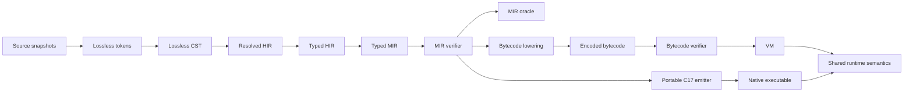

# Ruda Stage 0 compiler architecture

Status: implementation architecture for the C17 bootstrap.
Last reviewed: 2026-08-14.

This document maps the normative compiler and execution contracts to physical
owners. It changes no language semantics. When it conflicts with `docs/spec/`
or an accepted design decision, the higher-authority document wins and this
map must be corrected before implementation proceeds.

The supporting external evidence is recorded in
[`../research/compiler-architecture.md`](../research/compiler-architecture.md).

## Central architecture



Typed MIR is the only semantic convergence point. Backends may reject a typed
MIR feature they do not yet implement, but they may not reinterpret types,
evaluation order, bounds, arithmetic, panic identity, cleanup, or managed
identity. A preview feature is incomplete until both engine paths and the
differential harness cover it.

## Owners and allowed dependencies

| Owner | Owns | May depend on | Must not own |
|---|---|---|---|
| `source` | exact bytes, snapshots, line mapping | base storage/UTF-8 | grammar or semantic types |
| `lex` | lossless tokenization and lexical limits | source, diagnostics, generated token/Unicode tables | parser recovery or typing |
| `syntax` / `parse` / `ast` | immutable lossless tree, recovery, semantic projection | lex, source, diagnostics | package resolution or MIR |
| `check` | package phases, symbols, type rules, exhaustiveness, typed-HIR-to-MIR coordination | AST, types, MIR builder, diagnostics | bytecode/native repair or runtime layout policy |
| `mir` | typed representation, builders, verifier, deterministic oracle | base, canonical types, shared numeric semantics | source-name lookup or backend-specific types |
| `bytecode` | opcode metadata, program format, encode/decode, verifier, MIR lowering | verified MIR, generated opcode registry | source semantics or C lowering |
| `vm` | frames and execution of verified bytecode | verified bytecode, shared runtime | type inference or bytecode repair |
| `native` | auditable C17 emission and tool invocation | verified MIR, shared runtime ABI | independent source lowering |
| `runtime` | managed objects, arrays, panic/arithmetic/bounds helpers, later GC/tasks/I/O | base/platform adapters | compiler AST/HIR or engine-specific semantics |
| `cli` | target discovery and reusable service orchestration | compiler/tool libraries | duplicate parser/checker/backend implementations |

Dependencies flow downward through public headers. Private headers expose only
the state needed by sibling files in the same owner. A private header is not a
shortcut for sharing checker internals with a backend.

## Phase contracts

### Frontend to checker

- The CST remains lossless and source-owned.
- AST/HIR projections preserve stable source spans and invalid origins.
- Package checking orders collection, imports/visibility, signatures, and
  bodies deterministically.
- Recovery state can produce diagnostics but cannot be published as valid
  typed HIR or MIR.

### Checker to MIR

- The checker lowers all implicit observable behavior before publication.
- A `RudaMirFunction` is either failure-atomically owned by its result or not
  published.
- The builder does not substitute for the verifier; malformed structures built
  by tests must be rejected independently.
- Source-order evaluation, checked operations, bounds, cleanup, and panic spans
  are explicit operations or edges.

### MIR to engines

- `ruda_mir_verify` is required before oracle, bytecode, or native execution.
- Bytecode lowering may return an explicit unsupported-feature result; it must
  not omit an instruction.
- The bytecode decoder/verifier treats bytes as hostile and finishes before VM
  execution.
- The C emitter uses explicit temporaries and runtime helpers where a host C
  expression could introduce undefined, unspecified, locale-dependent, or
  backend-divergent behavior.

### Engines to runtime

- VM and generated C use the same semantic helper contracts for managed arrays,
  checked arithmetic where required, panic identity, and later GC/task/I/O
  behavior.
- Backend frames/addresses are not semantic identities.
- Runtime helpers do not accept unverified type/layout identifiers without
  checking their own public boundary.

## Physical decomposition plan

The current public headers remain stable during behavior-preserving extraction.
New files are linked into the same `ruda_bootstrap` library.

### MIR owner

The current `bootstrap/src/mir/mir.c` contains four cohesive units:

1. execution storage and lifecycle;
2. function representation lifecycle and builders;
3. instruction/layout plus CFG/dataflow verification;
4. semantic oracle execution.

After the active managed-array MIR slice is verified and committed, extract in
this order:

```text
bootstrap/src/mir/
  mir.c                 representation lifecycle and public builders
  mir_internal.h        owner-private const accessors only
  verify.c              local, CFG, and initialization verification
  execution.c           oracle execution graph and interpreter
```

`ruda_mir_verify` and `ruda_mir_interpret` retain their public signatures. No
representation or runtime semantics change in these extraction commits.

### Checker owner

The current `bootstrap/src/check/checker.c` combines infrastructure, expression
lowering, pattern analysis, statements/CFG, declaration phases, package
coordination, and result ownership. Extraction proceeds from the least coupled
boundaries:

```text
bootstrap/src/check/
  checker.c             package coordinator and stable public entry points
  checker_internal.h    owner-private contexts and phase contracts
  result.c              result/default/dispose/accessor ownership (extracted)
  array.c               D045 type/literal/access/assignment lowering (extracted)
  declarations.c        collection, signature, and publication phases
  expression.c          expression typing/lowering after its context is stable
  pattern.c             usefulness/exhaustiveness and pattern lowering
  statement.c           lexical scopes, control flow, and cleanup lowering
```

`ruda_check_package` remains the single coordinator. Pattern and statement
extraction waits until their shared binding/CFG state has an explicit private
contract; copying that state into feature-specific modules is forbidden.

### Test owners

Test decomposition precedes production extraction where it can preserve exact
test order and give each extracted owner a focused suite:

```text
tests/c-unit/
  test_mir.c
  test_mir_arrays.c
  test_mir_managed.c       future record/enum managed-oracle extraction
  test_mir_support.h
  test_checker.c
  test_checker_arrays.c
  test_checker_match.c
  test_checker_support.h
```

The existing `ruda_test_mir` and `ruda_test_checker` aggregators retain their
registrations. A new semantic owner may add one adjacent registered entry point
when that keeps new coverage out of an existing hotspot; splitting existing
tests must not delete, rename, reorder, or weaken assertions.

## Extraction checkpoint contract

Every physical extraction must satisfy all of the following:

1. no source, MIR, bytecode, runtime, diagnostic, or CLI semantics change;
2. public headers remain unchanged unless an ownership defect makes that
   impossible and the change is reviewed separately;
3. the diff is mechanical enough to compare moved bodies with their originals;
4. focused tests for the extracted owner pass;
5. the full C unit suite passes in debug and release;
6. ASan+UBSan passes for an extraction touching allocation or execution;
7. generated freshness and documentation checks pass;
8. roadmap/evidence records exact commands, environment, limitations, and
   commit identity.

An extraction is not combined with a new language feature. If a feature needs
an internal interface first, land and verify the interface extraction, then
land the vertical feature slice.

## Vertical feature contract

Each new preview surface follows the same path:

```text
syntax/formatter fixture
  -> checker pass/fail and diagnostic
  -> verified typed MIR and oracle result
  -> encoded/verified bytecode and VM result
  -> generated C17 debug/release and native result
  -> VM/native output, result bits, and panic identity comparison
```

The first implementation checkpoint for a surface may stop at MIR only when it
is explicitly named an internal foundation and leaves all public CLI claims
unavailable. The next checkpoint priority is then backend completion, not an
unrelated broad source feature.

## Pass and analysis discipline

The preview needs only a small sequential pass driver. Each future MIR pass
nevertheless declares:

- function or module scope;
- required verified input state;
- analyses read;
- analyses preserved or invalidated;
- whether observable source spans or panic identities can change;
- a deterministic dump before/after in test mode.

Debug/test pipelines verify after every transform. Persistent query caching is
deferred until session-local `PackageId`/`ItemId`/`FunctionId`, content
fingerprints, dependency edges, and invalidation fixtures exist. No hidden
process-global mutable compiler state is introduced in the interim.

## Current hotspot inventory

As measured on 2026-08-13 before the first extraction:

| File | Lines | Current responsibilities |
|---|---:|---|
| `bootstrap/src/check/checker.c` | 14,559 | checker contexts, declarations, expressions, patterns, statements/CFG, MIR coordination, result ownership |
| `tests/c-unit/test_checker.c` | 8,262 | all checker domains and failure injection |
| `bootstrap/src/mir/mir.c` | 4,536 | storage/builders, verifier, managed oracle graph, interpreter |
| `tests/c-unit/test_mir.c` | 3,387 | scalar, verifier, call, record, enum, and oracle tests |

These counts justify review, not a hard maximum. The completion criterion is
that each extracted module has one owner, a narrow private API, and independent
verification—not that every file falls below an arbitrary number.

## Extraction progress

The first behavior-preserving extraction landed after the managed-array oracle
checkpoint:

| Owner | Before | After | Boundary |
|---|---:|---:|---|
| `tests/c-unit/test_mir.c` | 4,612 | 3,396 | scalar, verifier, calls, records, enums, strings, and `f64`; remains the registered aggregator |
| `tests/c-unit/test_mir_arrays.c` | 0 | 1,251 | array layouts, construction, provenance, bounds, allocation failure, limits, and D045 RHS ordering |
| `bootstrap/src/check/checker.c` | 14,559 | 14,299 | package/checking phases remain coordinated here; published-result ownership moved out |
| `bootstrap/src/check/result.c` | 0 | 263 | defaults, nested published-value cleanup, rollback helpers, public dispose, and const accessors |
| `bootstrap/src/check/checker.c` | 14,299 | 14,246 | owner-private checker/function/expression contexts moved to the sibling-module contract |
| `bootstrap/src/check/checker_internal.h` | 21 | 121 | result lifecycle plus minimal expression-lowering context and helper boundary |
| `bootstrap/src/check/checker.c` | 14,246 | 14,481 | `Array<T>` type/signature integration and expression/call/assignment dispatch remain in the coordinator |
| `bootstrap/src/check/array.c` | 0 | 912 | D045 layout, literal, index, `length`, and checked-store lowering behind the private boundary |
| `bootstrap/src/check/checker_internal.h` | 121 | 153 | bounded D045 sibling-module contract; still uninstalled and owner-private |
| `tests/c-unit/test_checker_arrays.c` | 0 | 548 | source array typing, matrix oracle, G4002, diagnostics, limits, and allocation-failure ownership |

The split preserves assertion order within the array suite and the single
external `ruda_test_mir` registration. Test-local helpers are private to each
translation unit; no production header or semantic implementation changed.
The command evidence is recorded in
[architecture checkpoint 2](evidence/architecture-checkpoint-2-2026-08-14.md)
and
[architecture checkpoint 3](evidence/architecture-checkpoint-3-2026-08-14.md),
followed by the
[checker sibling-module boundary](evidence/architecture-checkpoint-4-2026-08-14.md)
and the first semantic consumer of that boundary in
[V0 source arrays iteration 11](evidence/v0-source-arrays-iteration-11-2026-08-14.md).
