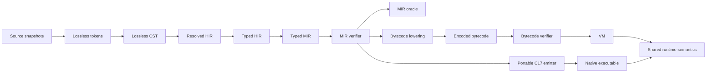

# Marimay Stage 0 compiler architecture

Status: implementation architecture for the C17 bootstrap.
Last reviewed: 2026-08-24.

This document maps the normative compiler and execution contracts to physical
owners. It changes no language semantics. When it conflicts with `docs/spec/`
or an accepted design decision, the higher-authority document wins and this
map must be corrected before implementation proceeds.

The supporting external evidence is recorded in
[`../research/compiler-architecture.md`](../research/compiler-architecture.md).

## Central architecture



Typed MIR is the only semantic convergence point. Backends may reject a typed
MIR feature they do not yet implement, but they may not reinterpret types,
evaluation order, bounds, arithmetic, panic identity, cleanup, or managed
identity. A preview feature is incomplete until both engine paths and the
differential harness cover it.

## Owners and allowed dependencies

| Owner | Owns | May depend on | Must not own |
|---|---|---|---|
| `source` | exact bytes, snapshots, line mapping | base storage/UTF-8 | grammar or semantic types |
| `lex` | lossless tokenization and lexical limits | source, diagnostics, generated token/Unicode tables | parser recovery or typing |
| `syntax` / `parse` / `ast` | immutable lossless tree, recovery, semantic projection | lex, source, diagnostics | package resolution or MIR |
| `check` | package phases, symbols, type rules, exhaustiveness, typed-HIR-to-MIR coordination | AST, types, MIR builder, diagnostics | bytecode/native repair or runtime layout policy |
| `mir` | typed representation, builders, verifier, deterministic oracle | base, canonical types, shared numeric semantics | source-name lookup or backend-specific types |
| `bytecode` | opcode metadata, program format, encode/decode, verifier, MIR lowering | verified MIR, generated opcode registry | source semantics or C lowering |
| `vm` | frames and execution of verified bytecode | verified bytecode, shared runtime | type inference or bytecode repair |
| `native` | auditable C17 emission and tool invocation | verified MIR, shared runtime ABI | independent source lowering |
| `runtime` | managed objects, arrays, panic/arithmetic/bounds helpers, later GC/tasks/I/O | base/platform adapters | compiler AST/HIR or engine-specific semantics |
| `cli` | target discovery and reusable service orchestration | compiler/tool libraries | duplicate parser/checker/backend implementations |

Dependencies flow downward through public headers. Private headers expose only
the state needed by sibling files in the same owner. A private header is not a
shortcut for sharing checker internals with a backend.

## Phase contracts

### Frontend to checker

- The CST remains lossless and source-owned.
- AST/HIR projections preserve stable source spans and invalid origins.
- Package checking orders collection, imports/visibility, signatures, and
  bodies deterministically.
- Recovery state can produce diagnostics but cannot be published as valid
  typed HIR or MIR.

### Checker to MIR

- The checker lowers all implicit observable behavior before publication.
- A `MarimayMirFunction` is either failure-atomically owned by its result or not
  published.
- The builder does not substitute for the verifier; malformed structures built
  by tests must be rejected independently.
- Source-order evaluation, checked operations, bounds, cleanup, and panic spans
  are explicit operations or edges.

### MIR to engines

- `mmay_mir_verify` is required before oracle, bytecode, or native execution.
- Bytecode lowering may return an explicit unsupported-feature result; it must
  not omit an instruction.
- The bytecode decoder/verifier treats bytes as hostile and finishes before VM
  execution.
- The C emitter uses explicit temporaries and runtime helpers where a host C
  expression could introduce undefined, unspecified, locale-dependent, or
  backend-divergent behavior.

### Engines to runtime

- VM and generated C use the same semantic helper contracts for managed arrays,
  checked arithmetic where required, panic identity, and later GC/task/I/O
  behavior.
- Backend frames/addresses are not semantic identities.
- Runtime helpers do not accept unverified type/layout identifiers without
  checking their own public boundary.

## Physical decomposition plan

The current public headers remain stable during behavior-preserving extraction.
New files are linked into the same `mmay_bootstrap` library.

### Enforced module-size contract

Every handwritten production and test translation unit must be understandable
from a bounded context packet: this document, its narrow public/private
contract, the owner implementation, and its focused tests. Requiring an agent
or reviewer to load an unrelated multi-thousand-line file is an architecture
defect.

- Target 500–1,200 physical lines per handwritten `.c`; hard ceiling 1,500.
- Target 50–250 physical lines per owner-private `.h`; hard ceiling 400.
  Owner API headers, including every handwritten header under
  `bootstrap/include/mmay/` and `runtime/include/mmay/`, have a tighter hard
  ceiling of 160. Generated artifacts are the only standing exemption.
- Temporary exceptions live only in `architecture-exceptions.tsv`. They name
  the exact path, owner, explicit ceiling, reason, and removal checkpoint. An
  exception is migration debt, not permission to add feature logic.
- A valid split moves semantic ownership into independently compiled
  translation units. Handwritten `.inc` shards, inclusion of `.c` files,
  include facades, and giant internal headers do not count.
- Line count cannot excuse mixed ownership: a coordinator below the ceiling
  that still implements declarations, expressions, patterns, CFG, and
  publication is a god object and must be divided.
- Stable coordinators have tighter path-specific ceilings in the executable
  gate: checker 650, parser/MIR model/formatter 1,200, and bytecode model,
  VM, and CLI 900 lines. The checker shared internal contract is capped at 250
  lines. These are ceilings, not growth targets.

`tools/check-architecture` enforces the mechanical portion on every push and
pull request. Its policy self-check proves that non-bytecode public headers are
discovered and that 160 lines are accepted while 161 are rejected. Review and
checkpoint evidence enforce cohesive ownership.

### MIR owner

Checkpoint 0 established these independently compiled owners:

```text
bootstrap/src/mir/
  mir.c                 representation lifecycle and public builders
  mir_internal.h        narrow sibling contracts
  verify.c              local, CFG, and initialization verification
  verify_support.c      type/dataflow verifier primitives
  verify_managed.c      string/record/enum/array layout verification
  verify_range.c        verified array proof-capability validation
  range.c               transactional checked-to-in-bounds MIR rewrite
  integer_range.c       MIR adapter, transactional arithmetic rewrite, proof validation
  verify_interfaces.c   interface metadata and nominal payload verification
  verify_io.c           exact D046 stdout instruction/layout verification
  verify_format.c       D065 primitive-format and concat verification
  verify_parse.c        D065 Result<int, ParseError> layout verification
  execution.c           oracle graph and interpreter dispatch
  execution_array.c     checked and verifier-gated in-bounds array execution
  execution_heap.c      execution state and managed allocations
  execution_io.c        D046 oracle publication and Result construction
  execution_format.c    locale-independent formatting and counted concat
  execution_parse.c     D065 integer parsing and ParseError construction
```

`mmay_mir_verify` and `mmay_mir_interpret` retain their public signatures. No
representation or runtime semantics change in these extraction commits.

### Checker owner

Checkpoint 0 leaves `checker.c` as the package coordinator and gives every
semantic family an independently compiled owner:

```text
bootstrap/src/check/
  checker.c             package coordinator and stable public entry points
  checker_internal.h    common utility/forward contract only
  checker_*_context.h   narrow package/function/match state contracts
  checker_core.c        shared checker operations and type helpers
  checker_lookup.c      deterministic name/type lookup
  checker_lookup_imports.c
                        file-local imported names and D043 owned lookup
  checker_imported_nominal.c
                        imported record/enum MIR layout adaptation
  checker_imported_enums.c
                        concrete imported-enum checker views and payload metadata
  checker_declaration_*.c
                        lifecycle, constants, functions, nominal families,
                        and publication phases
  checker_expression.c  expression dispatcher only
  checker_expr_*.c      scalar, call, nominal, and record expression owners
  checker_compound_types.c
                        tuple/function type recognition and interning
  checker_expr_tuples.c tuple value lowering and recursive MIR layout ownership
  checker_tuple_match.c tuple-pattern binding and match lowering
  checker_range_loop.c  exact D068 integer-range loop CFG lowering
  checker_expr_io.c     exact imported std/io.println recognition and lowering
  checker_expr_string.c interpolation plus closed std/convert lowering
  checker_match_*.c     binding, analysis, patterns, witnesses, dispatch,
                        and lowering
  checker_cfg.c         block/edge/value-state ownership
  checker_statement.c   lexical statement/control-flow lowering
  checker_publication.c checked-package publication
  checker_interpret.c   checked-result MIR oracle adapter
  checker_*_api.h       one narrow contract per sibling owner
  result.c              result/default/dispose/accessor ownership
  facts.c               canonical definition/reference fact publication
  queries.c             result-scoped definition/search/completion queries
  resolution.c          shared D003/D043 resolver and exact completion facts
  checker_receiver_calls.c
                        receiver-directed package/prelude collection dispatch
  checker_array_types.c D054 prefix-type recognition and existing array interning
  package_graph.c       bounded deterministic local-package graph coordinator
  package_imports_api.h narrow graph/checker import contract
  service.c             snapshots, package-graph checks, frontend lifetimes
  service_queries.c     generation/snapshot-safe compiler-service queries
  type_spelling.c       bounded canonical checked-type display ownership
  array.c               D045 type/literal/access/assignment lowering
  entry.c               root main and structural Error-contract selection
```

`mmay_check_package` remains the single-package coordinator;
`mmay_check_package_graph` owns only canonical graph ordering, import binding,
and repeated package-phase orchestration. One graph check uses one result and
one type table; independently checked package results are never concatenated.
Pattern and statement owners share only explicit context contracts; copying
that state into feature-specific modules is forbidden. Recursive expression
lowering returns through the dedicated dispatcher contract instead of making
a record/scalar owner the implicit hub.

`mmay_compiler_service_check` is the reusable owner above the frontend and
checker. It retains immutable source snapshots, rejects stale overlay versions,
orders current documents by exact path, and owns lex/parse/AST/check teardown.
`mmay_compiler_service_check_request` can reuse immutable top-level parse
subtrees from one exact versioned edit, polls cooperative cancellation between
bounded phases, and still rechecks the whole semantic package. It introduces
no persistent semantic cache and does not duplicate semantic lookup.
Successful diagnostic-free checks publish bounded, result-owned top-level
definition facts and references to that stable symbol universe in canonical
source order. `facts.c` owns publication, occurrence canonicalization, and
cross-fact validation; `queries.c` owns allocation-free result-scoped
definition-from-reference, byte-prefix package-symbol search, and completion
access. Source-path hashing consumes exact bytes, and nominal-receiver lookup
is indexed during declaration collection. Result-local `MarimayTypeId` values do
not cross the query boundary; receiver and candidate identity use stable
`MarimaySymbolId` values.

Package-local and imported non-generic free and dot calls share one resolver in
`resolution.c`: same-name functions are accepted only for distinct exact local
nominal receivers after alias unwrap, both spellings lower to one symbol, and
the dot receiver is evaluated once before explicit arguments. The same live
resolver publishes per-snapshot dot completion after signature collection;
the compiler service never reconstructs candidates by filtering published
function vectors. Canonical package surfaces provide D043 public candidates,
and import bindings contribute only the available named, aliased, namespace,
or empty free spelling. `service.c` maps current documents into one bounded
package-graph check, while `service_queries.c` rejects both older result
generations and snapshots outside the supplied current result. Full semantic
rechecking provides public/private/import-aware invalidation without a hidden
persistent semantic cache.

`checker_receiver_calls.c` owns the narrow collision boundary between ordinary
D003/D043 collection names and compiler-known `[]T` operations. It parses
only receiver-bearing `push` and `length` calls, compiles the receiver once,
asks the live resolver for an exact nominal candidate, and dispatches either to
ordinary call lowering or to `array.c`. Namespace-qualified calls remain with
the import resolver. `array.c` therefore owns only the selected D045 operation;
it does not shadow ordinary functions by spelling, and neither VM nor native
lowering repairs source-level candidate selection.

`checker_array_types.c` owns recognition of the D054 `[]T` AST prefix and
interns the unchanged D045 array descriptor. Public-signature visibility
recurses through that element node rather than treating `Array` as reserved.
`type_spelling.c` renders result-local checked types for compiler-service
hover/signature consumers with explicit depth/byte limits and caller-owned
output; `service_queries.c` supplies current-generation validation. The
formatter adjacency predicate lives in `formatter_types.c`; none of these
owners changes MIR, bytecode, runtime layout, or ABI.

The present occurrence universe covers stable top-level type, constant, and
resolved call references. Local bindings, record fields, enum variants,
generic instantiations, effect metadata, and production indexing/LSP transport
remain later I2/I8 work. Public `mmay check` now owns fresh disk-snapshot target
discovery and delegates the authoritative selected graph to this service; it
reports an internal failure instead of success for a checker-incomplete
accepted construct.

### Test owners

Test aggregators now contain only the original ordered suite calls. Focused
translation units mirror production owners:

```text
tests/c-unit/
  test_checker.c                  ordered aggregator
  test_checker_{core,records,enums,enum_match,match_scalar,
                match_control,calls_constants,operators,control,failures}.c
  test_checker_imports.c
  test_checker_imports_determinism.c
  test_checker_imports_support.{h,c}
  test_checker_support.{h,c}
  test_mir.c                      ordered aggregator
  test_mir_{scalar,calls,records,enums,arrays,arrays_rhs}.c
  test_mir_support.{h,c}
  test_bytecode_{model,program,support}.c
  test_bytecode_vm_{scalar,arithmetic,arrays,support}.c
  test_mir_bytecode_{model,programs,support}.c
  test_native_c_emitter_{baseline,arrays,array_access,scalar,matrix,strings,
                         imports,support}.c
  runtime/test_managed_array_access.c
  test_parser_{core,declarations,expressions,incremental,support}.c
  test_parser_array_types.c
  test_formatter_{core,trivia,failures,support}.c
  test_formatter_array_types.c
  test_checker_array_types.c
  test_pre1_surface_differential.c
                        D067-D075 checker/MIR/VM/native integration contract
  test_compiler_service_array_types.c
  test_cli_cp18_array_spelling.c
  test_check_entry.c
  test_cp9_io_pipeline.c
  test_cli_run.c
  test_runtime_io.c
  test_cp31_program_arguments.c
  runtime/test_program_arguments.c
```

The existing `mmay_test_mir` and `mmay_test_checker` aggregators retain their
registrations. A new semantic owner may add one adjacent registered entry point
when that keeps new coverage out of an existing hotspot; splitting existing
tests must not delete, rename, reorder, or weaken assertions.

### Remaining Stage 0 owners

Checkpoint 0 applies the same rule to every existing hotspot, not only checker
and MIR:

```text
bootstrap/src/parse/       parser coordinator/tree builder, expression/pattern/
                           type grammar, declaration/statement grammar
bootstrap/src/format/      formatter/render coordinator, token collection and
                           import ordering
bootstrap/src/bytecode/    model/builders, codec, verifier orchestration,
                           instruction verifier, CFG provenance verifier, MIR
                           lowering, VM coordinator, VM preflight, and VM value
                           operations
bootstrap/src/native/      C-emission coordinators and focused instruction/
                           descriptor owners; native build orchestration;
                           profile-specific runtime artifact discovery,
                           validation, and content identity
bootstrap/src/cli/         dispatch/options/help, format actions, and target
                           discovery/traversal
bootstrap/src/lex/         public result lifecycle and scanner/tokenization
bootstrap/src/manifest/    public result lifecycle, parser, and formatter
runtime/common/            managed heap core and focused object families
tests/c-unit/              focused suites mirroring those production owners
```

D059 assigns the generated-C/runtime array boundary specifically to
`bootstrap/src/native/c_emitter_range.c`,
`runtime/common/managed_array_access.c`, and the owner API
`runtime/include/mmay/runtime/array_access.h`. The emitter owner recognizes
only verifier-approved checked/in-bounds instruction pairs and preserves
barrier spans. The runtime owner resolves and validates one exact access; it
does not expose mutable heap state or retain a cell pointer. VM range dispatch
uses the same exact API after obtaining its verified program descriptor.

D060 assigns array representation, descriptor/stride validation, dense raw
packing, zero-initialized growth, and exact storage-byte accounting to
`runtime/common/managed_array_storage.c`. Its narrow owner-private
`managed_array_storage_internal.h` provides the checked-callers-only inlined
byte-copy primitive so the separately linked D059 boundary does not add a
second hot runtime call. The heap core owns slot publication and collection
coordination, access owns the D059 call boundary, and mutation owns D053
sequencing; none duplicates descriptor selection or raw/reference semantics.
`bootstrap/src/native/c_emitter_descriptors.c` and
`bootstrap/src/bytecode/vm_array.c` map their already verified scalar element
types to the same closed runtime layout tags without changing MIR or bytecode
wire identity. Focused storage tests inspect private layout/accounting while
native descriptor tests prove the emitted mapping.

D061 assigns capacity rounding, checked maximum clamping, rooted collection
retry, resize accounting, and failure-atomic commit to
`runtime/common/managed_array_capacity.c`. Construction remains in the storage
owner and deliberately bypasses this planner when its final count is known.
Mutation supplies only the requested minimum and any temporary reference root;
it does not duplicate rounding or retain resolved storage. Bytecode and native
construction/reserve paths converge on the same runtime owners, so neither
backend owns a shadow capacity policy.

D062 assigns representation-independent interval lattice math, branch
refinement, and bounded widening to `bootstrap/src/base/integer_range.c` behind
the narrow `mmay/base/integer_range.h` owner API. MIR adaptation,
checked-to-proven transactional rewrites, and MIR proof validation live in
`bootstrap/src/mir/integer_range.c`; hostile serialized-opcode reconstruction
lives separately in
`bootstrap/src/bytecode/bytecode_verify_integer_range.c`. The bytecode and MIR
owners translate their own models but share every arithmetic transfer/proof
rule. VM/MIR/native execution only consumes already verified proven forms and
uses the portable unsigned-domain helpers in `checked_i64.c`; no backend grants
or repairs a proof.

D063 assigns activation-view declaration and companion-state emission to
`bootstrap/src/native/c_emitter_emit.c`, array access use to
`bootstrap/src/native/c_emitter_range.c`, array mutation use to
`bootstrap/src/native/c_emitter_array_mutation.c`, and record projection use to
`bootstrap/src/native/c_emitter_managed.c`. The runtime bind/access owners are
`runtime/common/managed_array_access.c` behind the narrow
`mmay/runtime/array_view.h` contract and `runtime/common/managed_record.c`
behind `mmay/runtime/record.h`. Views contain no copied storage address and do
not own memory. The emitter coordinator owns the conservative transitive
safepoint predicate and root-location placement because those are activation
construction decisions; runtime owners do not infer compiler liveness.
`mmay/base/checked_i64_fast.h` is a header-only emission boundary mirroring the
portable checked/proven implementation, not a second semantic arithmetic
owner.

D066 assigns bounded counted-UTF-8 validation and managed `[]string`
construction to `runtime/common/program_arguments.c` behind
`mmay/runtime/program_arguments.h`. POSIX byte import and Windows wide-CRT
conversion remain separate platform owners in
`runtime/platform/{posix,windows}/program_arguments.c`. The checker entry owner
selects only the accepted root signatures;
`bootstrap/src/bytecode/vm_arguments.c` constructs the verified VM parameter;
and `bootstrap/src/native/c_emitter_entry.c` owns the host scaffold, argument
construction, common cleanup, and public status/result mapping. The emitter
coordinator only sequences that boundary. `bootstrap/src/cli/cli_program_arguments.c` owns separator-value
validation shared by run and test. The focused runtime and CP31 CLI suites
cover limits, encoding, allocation rollback, VM/native argument identity,
result/status precedence, and lexical cleanup without adding process semantics
to a backend.

The exact filenames may follow the stable concepts already present in the
code, but responsibility boundaries and dependency direction are fixed. A
single broad `util.c` or `support.c` that merely relocates unrelated code is
not an owner.

## Extraction checkpoint contract

Every physical extraction must satisfy all of the following:

1. no source, MIR, bytecode, runtime, diagnostic, or CLI semantics change;
2. public headers remain unchanged unless an ownership defect makes that
   impossible and the change is reviewed separately;
3. the diff is mechanical enough to compare moved bodies with their originals;
4. focused tests for the extracted owner pass;
5. the full C unit suite passes in debug and release;
6. ASan+UBSan passes for an extraction touching allocation or execution;
7. generated freshness and documentation checks pass;
8. roadmap/evidence records exact commands, environment, limitations, and
   commit identity.

An extraction is not combined with a new language feature. If a feature needs
an internal interface first, land and verify the interface extraction, then
land the vertical feature slice.

## Vertical feature contract

Each new preview surface follows the same path:

```text
syntax/formatter fixture
  -> checker pass/fail and diagnostic
  -> verified typed MIR and oracle result
  -> encoded/verified bytecode and VM result
  -> generated C17 debug/release and native result
  -> VM/native output, result bits, and panic identity comparison
```

The first implementation checkpoint for a surface may stop at MIR only when it
is explicitly named an internal foundation and leaves all public CLI claims
unavailable. The next checkpoint priority is then backend completion, not an
unrelated broad source feature.

## Pass and analysis discipline

The preview needs only a small sequential pass driver. Each future MIR pass
nevertheless declares:

- function or module scope;
- required verified input state;
- analyses read;
- analyses preserved or invalidated;
- whether observable source spans or panic identities can change;
- a deterministic dump before/after in test mode.

Debug/test pipelines verify after every transform. Persistent query caching is
deferred until session-local `PackageId`/`ItemId`/`FunctionId`, content
fingerprints, dependency edges, and invalidation fixtures exist. No hidden
process-global mutable compiler state is introduced in the interim.

## Checkpoint 0 hotspot inventory

As measured on 2026-08-14 immediately before the full extraction:

| File | Lines | Mixed responsibilities |
|---|---:|---|
| `bootstrap/src/check/checker.c` | 15,112 | declarations, expressions, patterns, statements/CFG, package coordination |
| `tests/c-unit/test_checker.c` | 8,271 | all checker domains and failure injection |
| `bootstrap/src/mir/mir.c` | 5,373 | model/builders, verifier, managed oracle, interpreter |
| `bootstrap/src/bytecode/bytecode.c` | 3,363 | model, codec, verifier, disassembly |
| `tests/c-unit/test_mir.c` | 3,396 | scalar, verifier, calls, records, enums, oracle |
| `tests/c-unit/test_bytecode_vm.c` | 3,152 | every VM value family and failure mode |
| `bootstrap/src/parse/parser.c` | 2,992 | event engine, all grammar, tree builder, incremental parsing |
| `tests/c-unit/test_native_c_emitter.c` | 2,737 | all emitter and differential families |
| `tests/c-unit/test_parser.c` | 2,304 | all parser grammar, recovery, incremental, limits |
| `bootstrap/src/cli/cli.c` | 2,248 | options/help, format actions, target discovery |
| `tests/c-unit/test_mir_bytecode.c` | 2,003 | all lowering/program differential families |
| `tests/c-unit/test_bytecode.c` | 1,971 | model, codec, verifier, program, allocation tests |
| `bootstrap/src/bytecode/vm.c` | 1,865 | preflight, frames, values, strings, arrays, dispatch |
| `bootstrap/src/format/formatter.c` | 1,596 | collection/import ordering and document emission |
| `tests/c-unit/test_formatter.c` | 1,545 | fixtures, properties, limits, failure injection |

These counts triggered checkpoint 0. The 1,500-line ceiling is a hard automated
backstop, and cohesive ownership with a narrow private API is the human review
criterion. Both must pass.

### Checkpoint 0 result

The completed local tree has 94 production/platform C translation units and 82
unit/fuzz C translation units. The largest handwritten production or test file
is 1,175 lines; the largest owner-private header is 221 lines; the largest
checker owner API is 139 lines. The exception registry is empty. No handwritten
`.inc` shard or `.c` inclusion is used.

A post-checkpoint audit found that the first gate revision applied the public
owner-header ceiling only to the bytecode include subtree. The corrected gate
walks both complete public include trees. The former aggregate bytecode, MIR,
checker/service, type-system, and managed-runtime headers are now small
backwards-compatible umbrellas over self-contained semantic owner headers; the
largest handwritten public owner header is exactly 160 lines. This closes the
mechanical blind spot without changing ABI or source semantics.

| Owner family | Largest before | Largest after | Resulting boundary |
|---|---:|---:|---|
| checker | 15,112 | 1,137 | coordinator, declarations, expression dispatcher/families, match families, CFG/statements, publication |
| checker tests | 8,271 | 1,175 | exact-order aggregator plus focused semantic suites |
| MIR | 5,373 | 1,108 | model/builders, verifier families, oracle, execution heap |
| MIR tests | 3,396 | 1,089 | scalar/calls/nominals/arrays and shared fixtures |
| bytecode + VM | 3,363 | 1,017 | model, codec, verifier families, program/lowering, VM preflight/value/dispatch |
| bytecode + VM tests | 3,152 | 1,072 | model/program/scalar/arithmetic/array suites |
| parser | 2,992 | 1,150 | event/tree coordinator, expression/pattern/type grammar, declaration/statement grammar |
| parser tests | 2,304 | 918 | core, declarations, expressions, incremental/limits |
| native emitter | 1,343 | 525 | coordinator/descriptors, validation, instruction/function emission |
| native emitter tests | 2,737 | 867 | baseline, arrays, scalar/f64, matrix, strings/panic |
| CLI | 2,248 | 826 | dispatch/options, format actions, target discovery |
| formatter | 1,596 | 1,115 | rendering coordinator and collector/import ordering |
| lexer | 1,231 | 1,161 | public lifecycle and scanner/tokenization |
| manifest | 1,284 | 698 | public lifecycle, parser, formatter |

## Extraction progress

The first behavior-preserving extraction landed after the managed-array oracle
checkpoint:

| Owner | Before | After | Boundary |
|---|---:|---:|---|
| `tests/c-unit/test_mir.c` | 4,612 | 3,396 | scalar, verifier, calls, records, enums, strings, and `f64`; remains the registered aggregator |
| `tests/c-unit/test_mir_arrays.c` | 0 | 1,251 | array layouts, construction, provenance, bounds, allocation failure, limits, and D045 RHS ordering |
| `bootstrap/src/check/checker.c` | 14,559 | 14,299 | package/checking phases remain coordinated here; published-result ownership moved out |
| `bootstrap/src/check/result.c` | 0 | 263 | defaults, nested published-value cleanup, rollback helpers, public dispose, and const accessors |
| `bootstrap/src/check/checker.c` | 14,299 | 14,246 | owner-private checker/function/expression contexts moved to the sibling-module contract |
| `bootstrap/src/check/checker_internal.h` | 21 | 121 | result lifecycle plus minimal expression-lowering context and helper boundary |
| `bootstrap/src/check/checker.c` | 14,246 | 14,481 | `[]T` type/signature integration and expression/call/assignment dispatch remain in the coordinator |
| `bootstrap/src/check/array.c` | 0 | 1,371 | D045 layout, literal, index, selected `length`/`push`, and checked-store lowering behind the private boundary |
| `bootstrap/src/check/checker_receiver_calls.c` | 0 | 210 | exact receiver-directed ordinary/Array candidate dispatch with once-only receiver evaluation |
| `bootstrap/src/check/checker_internal.h` | 121 | 153 | bounded D045 sibling-module contract; still uninstalled and owner-private |
| `tests/c-unit/test_checker_arrays.c` | 0 | 548 | source array typing, matrix oracle, G4002, diagnostics, limits, and allocation-failure ownership |
| `bootstrap/src/check/service.c` | 0 | 839 | versioned snapshots, exact edit proofs, request-local parse reuse, phase-boundary cancellation, canonical package recheck, and transactional teardown |
| `tests/c-unit/test_compiler_service.c` | 0 | 616 | multi-file order, retained overlays, stale versions, aggregate limits, transactional reuse, and fail-every-allocation cleanup |
| `tests/c-unit/test_compiler_service_incremental.c` | 0 | 869 | exact edit validation, parse reuse/fallback, multi-file semantic recheck, cancellation, result provenance/lifetimes, and fact stability |
| `bootstrap/src/check/checker.c` | 14,481 | 14,898 | bounded fact seeds, receiver-aware identity, and indexed local-nominal ownership remain package-phase coordination |
| `bootstrap/src/check/facts.c` | 0 | 159 | fact-name ownership, canonical ordering, collision rejection, and symbol-ID lookup index |
| `bootstrap/src/check/result.c` | 263 | 340 | definition-fact/package-name lifetime plus exact declaration accessors |
| `tests/c-unit/test_checker_facts.c` | 0 | 804 | five-kind inventory, canonical order, exact identity, limits, diagnostics, and allocation cleanup |
| `bootstrap/src/check/queries.c` | 0 | 168 | allocation-free result-scoped occurrence, definition, prefix-search, and completion access |
| `bootstrap/src/check/service_queries.c` | 0 | 171 | current-generation and exact-snapshot validation around result queries |
| `tests/c-unit/test_compiler_service_queries.c` | 0 | 839 | import-form completion/resolver equivalence, reverse order, overlays, stale safety, cancellation, limits, and fail-every-allocation cleanup |
| `tests/c-unit/test_receiver_collection_names.c` | 0 | 373 | same-name nominal/Array behavior, diagnostics, MIR/backend selection, and fail-every-allocation cleanup |
| `tests/c-unit/test_receiver_collection_service.c` | 0 | 419 | import-form completion/free-spelling/reference identity and compiler-service allocation cleanup |
| `tests/c-unit/test_cli_cp16_receiver_names.c` | 0 | 107 | public fmt/check/run/test-both/build/artifact acceptance for the checkpoint-16 corpus |
| `bootstrap/src/check/checker_array_mutation.c` | 0 | 522 | D053 typed mutation results, guards, and iterator-generation MIR lowering |
| `bootstrap/src/mir/execution_array.c` | 0 | 371 | alias-safe array capacity/mutation oracle and exact G4002/G4005 panics |
| `bootstrap/src/bytecode/vm_array_mutation.c` | 0 | 162 | verified mutation/generation opcode execution and G4005 mapping |
| `bootstrap/src/native/c_emitter_array_mutation.c` | 0 | 152 | portable-C mutation/generation emission and exact G4005 runtime helper |
| `runtime/common/managed_array_mutation.c` | 0 | 397 | failure-atomic storage mutation, reservation, generation, and precise slot release |
| `tests/c-unit/test_checker_array_mutation.c` | 0 | 130 | typed surface/MIR shape, diagnostics, and fail-every-allocation cleanup |
| `tests/c-unit/test_mir_array_mutation.c` | 0 | 110 | aliased MIR state plus exact iterator-invalidated message/span |
| `tests/c-unit/test_bytecode_vm_array_mutation.c` | 0 | 264 | malformed/round-trip/state/G4005 bytecode and VM allocation coverage |
| `tests/c-unit/test_native_c_emitter_array_mutation.c` | 0 | 115 | emitted runtime calls, strict-C execution, and allocation cleanup |
| `tests/c-unit/runtime/test_managed_mutation.c` | 0 | 361 | raw/reference/nested tracing, capacity, generation, and resize-failure coverage |
| `bootstrap/src/check/checker_array_types.c` | 0 | 73 | D054 prefix AST recognition and existing managed-array type interning |
| `bootstrap/src/format/formatter_types.c` | 0 | 15 | canonical D054 prefix adjacency without semantic rewriting |
| `bootstrap/src/check/type_spelling.c` | 0 | 253 | bounded canonical checked-type spelling for compiler-service consumers |
| `bootstrap/src/check/service_queries.c` | 171 | 214 | current-generation wrapper and status mapping for owned canonical type spelling |
| `tests/c-unit/test_checker_array_types.c` | 0 | 216 | identity, contextual empty arrays, migration diagnostics, nominal-name coexistence, and allocation cleanup |
| `tests/c-unit/test_compiler_service_array_types.c` | 0 | 194 | canonical nested/generic signatures, stale results, limits, and output allocation cleanup |
| `tests/c-unit/test_cli_cp18_array_spelling.c` | 0 | 132 | public fmt/check/run/test-both/build/G4002 differential acceptance |
| `tests/c-unit/test_cli_cp17_array_mutation.c` | 0 | 135 | public fmt/check/run/test-both/build/artifact and VM/native G4005 acceptance |
| `bootstrap/src/parse/parser_match.c` | 0 | 94 | D067 block-arm tail-expression recognition without a contextual transfer statement |
| `bootstrap/src/parse/parser_closure.c` | 0 | 105 | closure lookahead and optional contextual parameter/result annotations |
| `bootstrap/src/check/checker_range_loop.c` | 0 | 287 | D068 exact-once integer bounds, immutable binding, loop CFG, and inclusive-maximum safety |
| `bootstrap/src/check/checker_compound_types.c` | 0 | 125 | parenthesized tuple/function type recognition and deterministic interning |
| `bootstrap/src/check/checker_expr_tuples.c` | 0 | 262 | tuple construction plus recursive tuple layout availability across function boundaries |
| `bootstrap/src/check/checker_tuple_match.c` | 0 | 417 | tuple destructuring bindings, exhaustiveness, scoped projection, and typed arm joining |
| `bootstrap/src/format/formatter_layout.c` | 0 | 221 | D071 required singleton-tuple commas plus D073 blank-line preservation, boolean-chain breaks, and compact index grouping |
| `tests/c-unit/test_pre1_surface_differential.c` | 0 | 254 | D067-D075 positive integration, ignored-Result and range-value negatives, MIR oracle, VM, and native parity |
| `bootstrap/src/cli/cli_display.c` | 0 | 61 | bounded UTF-8-safe command-argument display escaping shared by diagnostics and formatter reporting |
| `bootstrap/src/cli/cli_heap_limit.c` | 0 | 83 | D055 decimal range, default, duplicate, and argument-location policy |
| `bootstrap/src/cli/cli_resource_report.c` | 0 | 48 | D055 classified human/short/JSON runtime-resource rendering shared by run and test |
| `runtime/common/managed_resource.c` | 0 | 53 | deterministic managed budget/host failure publication and read-only inspection |
| `tests/c-unit/runtime/test_managed_resource.c` | 0 | 262 | D055 exact boundary, raw/reference growth, semantic precedence, host-failure sweep, and zero-counter cleanup |
| `tests/c-unit/test_cli_heap.c` | 0 | 259 | D055 CLI range/help/JSON, test isolation, embedding/cache identity, and VM/native exact observations |
| `tests/c-unit/test_cli_cp20_algorithm_corpus.c` | 0 | 121 | reusable eight-algorithm fmt/check/VM/test-both/debug/release native acceptance with exact output parity |
| `runtime/common/managed_array_access.c` | 0 | 207 | D059 one-resolve exact descriptor/length/checked-or-proven cell access ABI |
| `bootstrap/src/native/c_emitter_range.c` | 42 | 225 | D059 barrier/access fusion, exact ABI emission, and G4002 span preservation |
| `tests/c-unit/runtime/test_managed_array_access.c` | 0 | 202 | D059 raw/reference, bounds, alias, stale-handle, safepoint, and no-allocation runtime coverage |
| `tests/c-unit/test_native_c_emitter_array_access.c` | 0 | 225 | D059 direct/checked-proof/static-proof generated-C inspection and O0/O2 execution |
| `runtime/common/managed_array_storage.c` | 0 | 540 | D060 descriptor validation, exact allocation/accounting, publication, and failure-atomic dense growth |
| `runtime/common/managed_array_storage_internal.h` | 0 | 82 | D060 C17 inline byte-copy primitive used only after descriptor/value/index validation |
| `runtime/common/managed_array_access.c` | 207 | 210 | D060 dense exact-access transfer while preserving the D059 one-resolve ABI |
| `runtime/common/managed_array_mutation.c` | 397 | 266 | D060 dense mutation transfer and no-op-capacity fast path without changing growth policy |
| `tests/c-unit/runtime/test_managed_array_storage.c` | 0 | 407 | D060 layout/bits/alignment/accounting/tracing/corruption/failure-atomic storage coverage |
| `tests/c-unit/test_bytecode_vm_array_storage.c` | 0 | 168 | unchanged generic-array wire round trip plus VM descriptor/bit mapping |
| `tests/c-unit/test_native_c_emitter_array_storage.c` | 0 | 185 | every raw stride, canonical f64, reference fallback, and strict-C execution |
| `runtime/include/mmay/runtime/array_view.h` | 0 | 148 | D063 non-escaping array-view ABI and validated C17 inline RAW64 access primitives |
| `bootstrap/include/mmay/base/checked_i64_fast.h` | 0 | 156 | D063 portable inline mirror of checked/proven i64 emission helpers |
| `runtime/common/managed_array_access.c` | 417 | 428 | D063 exact view bind plus growth-aware access and mutation without copied storage addresses |
| `runtime/common/managed_record.c` | 186 | 215 | D063 exact non-moving record-view bind |
| `bootstrap/src/native/c_emitter_emit.c` | 588 | 879 | D063 companion-view declarations, conservative transitive safepoint proof, and root-location placement |
| `bootstrap/src/native/c_emitter_managed.c` | 383 | 520 | D063 record-view projection plus mutation-capability-scoped identity guard for alias-replaced array fields |
| `tests/c-unit/runtime/test_managed_array_access.c` | 202 | 300 | D063 rooted collection, growth, allocation-free view, atomic failure, and stale/descriptor coverage |
| `tests/c-unit/runtime/test_managed_record_view.c` | 0 | 95 | D063 exact record view, rooted collection, no-allocation, wrong-type, and stale-handle coverage |
| `tests/c-unit/test_native_c_emitter_managed_views.c` | 0 | 118 | D063 nested record-array view, alias replacement, direct RAW64, rootless emission, and O0/O2 execution |
| `runtime/common/program_arguments.c` | 0 | 113 | D066 counted UTF-8 validation and failure-atomic managed `[]string` construction |
| `runtime/platform/posix/program_arguments.c` | 0 | 109 | D066 bounded POSIX argv import and owned UTF-8 views |
| `runtime/platform/windows/program_arguments.c` | 0 | 146 | D066 bounded wide-CRT validation and strict UTF-16-to-UTF-8 import |
| `bootstrap/src/bytecode/vm_arguments.c` | 0 | 43 | D066 verified entry-array descriptor binding for VM execution |
| `bootstrap/src/cli/cli_program_arguments.c` | 0 | 114 | D066 shared run/test separator-value validation and diagnostics |
| `tests/c-unit/runtime/test_program_arguments.c` | 0 | 253 | D066 validation, Unicode/platform conversion, managed values, and allocation cleanup |
| `tests/c-unit/test_cp31_program_arguments.c` | 0 | 556 | D066 run/test/build/native arguments, status, Result, panic, cleanup, diagnostics, and allocation coverage |

The earlier mechanical split preserves assertion order within the array suite
and the single external `mmay_test_mir` registration. The service checkpoint
adds an explicit public owner plus shared phase-option validators; it changes
no Marimay language semantics and leaves the public CLI unavailable.
The command evidence is recorded in
[architecture checkpoint 2](evidence/architecture-checkpoint-2-2026-08-14.md)
and
[architecture checkpoint 3](evidence/architecture-checkpoint-3-2026-08-14.md),
followed by the
[checker sibling-module boundary](evidence/architecture-checkpoint-4-2026-08-14.md)
and the first semantic consumer of that boundary in
[V0 source arrays iteration 11](evidence/v0-source-arrays-iteration-11-2026-08-14.md),
followed by
[the compiler-service foundation](evidence/i2-compiler-service-foundation-iteration-36-2026-08-14.md)
and its
[request-local incremental/cancellation checkpoint](evidence/i2-compiler-service-incremental-iteration-37-2026-08-14.md),
followed by
[successful-package definition facts](evidence/i2-checker-facts-iteration-38-2026-08-14.md).
The result-scoped query and exact checker-backed completion foundation is
recorded in
[preview checkpoint 3](evidence/i2-compiler-service-queries-checkpoint-3-2026-08-17.md).
The repository-wide bounded-context enforcement and full production/test
decomposition are recorded in
[A0 checkpoint 0](evidence/a0-bounded-architecture-checkpoint-0-2026-08-14.md).
